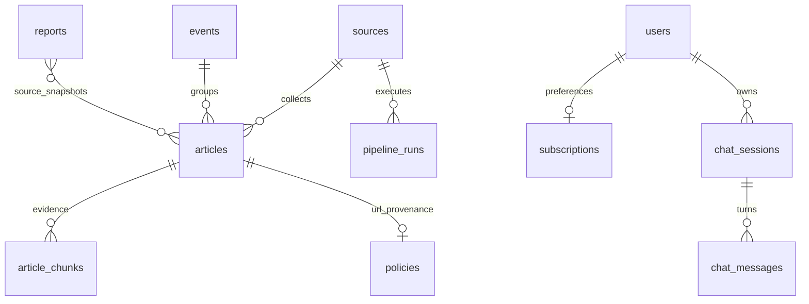
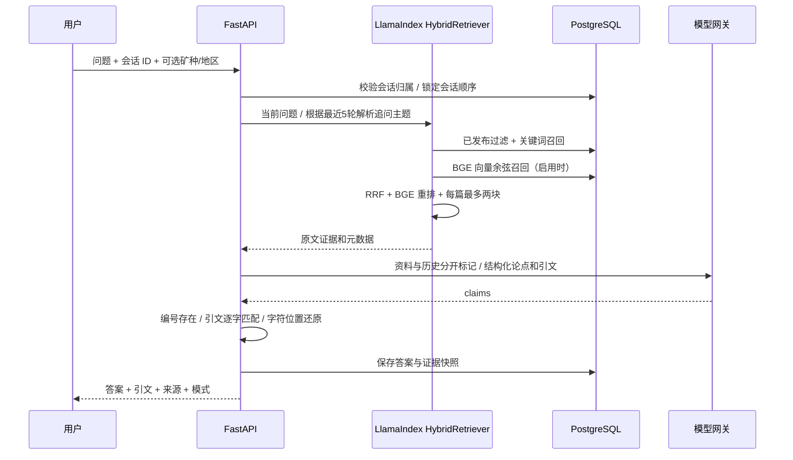

# 架构设计

## 系统分层

采用模块化单体 + 异步任务。FastAPI 控制权限与契约，services 承载业务，pipeline 承载来源适配和加工，rag 承载检索与咨询，Celery 承载重试与调度。先保证端到端一致性，保留按采集、推理、检索拆分的边界。

SQLAlchemy 2.0 AsyncSession 每请求/任务独立，禁止并发共享 session。Celery 多次使用 `asyncio.run`，当前引擎选择 NullPool 规避跨事件循环复用连接；增长后为 API 单独启用有界连接池、为 worker 维护长期 loop。[SQLAlchemy async 使用说明](https://docs.sqlalchemy.org/en/20/orm/extensions/asyncio.html)

## 数据实体

所有主键采用应用生成 UUID，日期采用 UTC `timestamptz` 或自然日 `date`，原文/译文分开，JSON 使用 JSONB，标签数组默认空数组，embedding 允许 null 并固定 1024 维。

- sources：用户要求的全部字段；约束类型、类别、权威度和最小采集频率，URL 唯一。
- articles：全部要求字段；扩展 processing_error；URL 唯一、状态约束、分数 0–100。原文保留，派生字段一次性提交。
- events：保留内部聚类表示、时间跨度、标签与聚类文章数。公开接口使用匹配的已发布文章生成标题、摘要、标签和分数，并单独计算已发布文章数，避免泄露尚未审核的报道。
- price_records：Numeric(20,6)，按矿种/单位/币种/日期/来源唯一，同序列计算 change_pct。
- policies：URL 唯一；日期缺失存 null；公开接口仅展示有已发布文章依据的政策。
- users：唯一小写邮箱、Argon2id 哈希、管理角色、启用状态；subscriptions 通过唯一 user_id 关联用户，避免复制邮箱。
- chat_sessions：拥有者、标题、创建时间；chat_messages：每轮 question/answer、sources_json、模式与时间。
- article_chunks：额外必需表，记录文章、序号、逐字原文、字符起止位置、检索文本和向量。比仅文章级向量能更准确引用长文。
- pipeline_runs / reports：持久任务记录、按周期唯一的报告。报告和会话引用使用 JSON 快照，保留生成时证据。

删除用户级联删除会话/消息/偏好；删除文章级联删除检索块；信源有文章时不能删除；删除事件只解除关联。迁移显式创建表/约束/索引，不在未来执行时依赖变化中的 ORM metadata。

数组 GIN 索引支持 contains/overlap，HNSW cosine 索引支持向量近邻，pg_trgm 支持中文包含匹配，全文 GIN 支持 simple 分词查询。BGE-M3 的 dense embedding 为 1024 维；[模型说明](https://huggingface.co/BAAI/bge-m3)、[pgvector 索引说明](https://github.com/pgvector/pgvector)。初始库表不分区；应按数据规模测量索引写入和候选过滤效果后决定分区。

## 采集与加工

1. 单实例 Beat 每分钟检查源自身 fetch_interval。失败尝试也参与间隔判断，避免不可用源被连续轰炸。
2. worker 使用有 TTL 且 token 所有权校验的 Redis 锁，记录运行状态。ETag/Last-Modified 用于条件请求。
3. 校验公网 DNS、标准 HTTP(S) 端口、每次重定向、robots、体积和超时；HTTP 不继承环境代理。动态页检查子请求目的地并屏蔽媒体。
4. 正文原样入库，URL 冲突忽略；价格 upsert。价格 JSON 原始响应额外作为带 hash fragment 的文档快照，不改动远端 API 路径，方便逐字引用。
5. 原始记录提交后才投递加工。投递失败留下 pending，Beat 补偿扫描；worker 行锁 + Redis 锁保证处理幂等。加工错误记录错误类型，Celery 自动重试后可人工触发。
6. 规则实体识别、权威度/正文长度启发式分数、可选 LLM 翻译摘要标签、原文分块、可选 BGE 编码、事件关联在独立任务完成。全量译文按 6000 字符批次请求，任一批次失败不会发布不完整译文。
7. 聚类限定最近 7 天、矿种和地区，启用向量时阈值 0.86；没有向量仅使用相同标题。当前全局 advisory lock 保证“寻找或创建事件”不重复；未来换为主题分桶锁和离线聚类。
8. 默认 processed 等待审核，明确配置才自动 published。定时报告读取完整 UTC 周期内已发布资讯，无文章则不生成空报告。

任务采用至少一次交付，数据库唯一约束与状态转换保证重复执行安全；并不声称 exactly-once。仍可能有 stale running 记录，例如硬杀 worker；运维需要监控运行时间并依据任务状态恢复。生产可增加任务 outbox 和 watchdog。[Celery 定时任务说明](https://docs.celeryq.dev/en/stable/userguide/periodic-tasks.html)

## 咨询路径

关键词使用 jieba、双语领域别名扩展、PostgreSQL FTS 与中文 ILIKE 补充，向量使用同一 BGE-M3 编码器。默认每通道召回 20，余弦距离小于 0.65，RRF k=60；融合前 20 个候选交给 [bge-reranker-v2-m3](https://huggingface.co/BAAI/bge-reranker-v2-m3) 精排，最终至多 5 块，每篇最多两块。筛选支持矿种、地区、类别与带时区的半开日期区间。阈值尚未用矿业标注集校准。

`articles.embedding` 使用中文标题、摘要、全文按顺序拼接，BGE tokenizer 截断到 512 token；原文片段独立编码用于精确引用。索引保存模型版本、内容与元数据哈希、索引时间。每小时扫描新增或修改文章，事务同步队列每 30 秒恢复 Qdrant 镜像。两套 collection 分别保存文章与片段，命中必须回查 PostgreSQL 发布状态与版本。全量重建使用 keyset 分页，不删除会话、文章或原文证据；详见 [阶段 2](phase2-rag.md)。

LlamaIndex SentenceSplitter 使用字符计数而非英语 token 默认值，块长 700、重叠 100。定位从上一个块尾附近开始，避免重复句段定位到错误位置。精确引文位置指入库原文，不是网页 DOM 位置，也不是译文位置。

无来源或模型返回空论点时回答“根据现有资料，未找到相关信息”；天气等独立话题不继承矿业历史。LLM 缺失/失败、JSON 不合法、引用不存在、引文不匹配或数值缺乏证据时回答 extractive。grounded 仅表示引用验证通过，语义蕴含、矛盾处理和时效判断必须用标注集评估。当前不包含独立事实核验模型与联网搜索工具。

## 安全与扩容

JWT 固定 HS256、issuer/audience/expiry，Argon2id 密码，普通注册不能指定管理员。每次操作读取数据库角色与启用状态，会话/订阅以当前用户为边界。前端 token 保存在内存，退出时清空 TanStack Query；刷新后需重新登录。生产下一步可加入 HttpOnly refresh cookie、撤销与 SSO。

登录和咨询每 IP/共享业务组每分钟 10 次，兼容别名共享组；其他 API 使用 SlowAPI 全局依赖，每 IP/HTTP 方法/路由模板每分钟 120 次，支持新旧 FastAPI 嵌套路由。生产强制 Redis，限流存储不可用时返回 503；Nginx API 另有每秒限制。API 仅在容器内部网络可达，Nginx 替换 forwarded headers；部署到其他拓扑时收紧 Uvicorn trusted proxies。配置拒绝生产弱密钥和通配 CORS；错误不回显密码或 SQL。

生产部署采集 worker 应处于受控 egress 网络，禁止到内网和云 metadata 的路由：应用层 DNS 预检不能单独保证 DNS rebinding 防护。遵循来源 robots、授权和限速策略；动态浏览器不得以 root 执行。

初始指标包含请求率、状态码与 P95 延迟，使用路由模板而非 UUID 作为标签。任务运行日志与文章错误供后台查看；后续补充队列积压、模型 token/成本、来源新鲜度与采集成功率指标。

扩容顺序：按 IO/NLP 队列独立扩 worker → 推理服务/GPU → 读副本与查询缓存 → 按时间归档/分区 → 依据实测引入独立向量库。变更模型必须版本化并批量重新编码，不允许混用维度相同但语义空间不同的向量。
