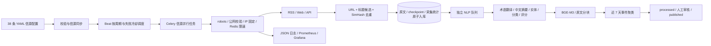

# 阶段 1：全球信源采集框架

本阶段提供 RSS、网页、JSON API 统一采集和可重放的加工流水线。`sources.yaml` 包含需求中的 **38 个信源条目**，权威评分是内部编辑先验。Mining Weekly、Mining Technology、Resource World 的公开 RSS 和 USGS 新闻列表/正文已通过真实请求，默认启用这 4 条。其他条目保留入口、解析配置、访问限制和验证状态，默认关闭。Reuters、Bloomberg、价格供应商和交易所商业数据需要核实使用许可或接入正式授权接口。

“Lithium Market”“Rare Earths News”“Graphite News”按主题频道解释，配置明确标注 Mining Weekly 为实际发布者；“Uranium Market”采用 World Nuclear News 入口。没有为这些泛称虚构独立新闻机构或 RSS 接口。

## 数据流和一致性



- HTTP ETag、Last-Modified 和 API 游标与原文在同一数据库事务提交。分页中途失败不会更新持久化游标。部分网页或 RSS 正文获取失败会记录错误，并清除条件请求校验器，以便下次重试。
- 原文入库之后才投递 NLP。Redis 投递失败不回滚已保存的原文，Beat 补投尚未处理的文章。翻译失败不会写入半成品，也不会标记为已翻译。
- RSS 首次只能获取摘要时，后续允许把未发布文章升级为正文并重新加工。已发布原文保持稳定；NLP 提交前检查原文是否发生变化，避免把旧摘要的译文和证据位置写到新正文上。
- 数据库 URL 唯一约束和 `ON CONFLICT DO NOTHING` 保证重放幂等。去重事务使用 PostgreSQL advisory lock，HTTP 和模型调用在事务之外执行。
- 标题 `SequenceMatcher >= 0.85` 表示重复候选；结合至少 200 字正文与 64 位 SimHash 汉明距离 ≤ 3，才丢弃相近转载。正文包含不同事实的报道保留各自出处，交由事件聚类关联。价格快照用内容摘要标识版本，普通 URL 清除追踪参数和片段。
- `articles.event_id` 保留事件成员关系。近 7 天使用向量相似度和标题相似度共同筛选；关闭 ML 时采用保守标题相似度。重要性由文章数 40%、平均信源权威性 35%、最近报道时效性 25% 加权计算。

## 配置与运行

先安装更新后的锁定依赖，执行新增迁移：

```powershell
# monorepo 根目录，已配置独立 PostgreSQL 16 和 Redis
.\.venv\Scripts\python.exe -m ensurepip --upgrade --default-pip
.\.venv\Scripts\python.exe -m pip install -r backend/requirements-dev.lock
.\.venv\Scripts\python.exe -m pip install --no-deps -e backend
.\.venv\Scripts\Activate.ps1
$env:PYTHONPATH = (Get-Location).Path
alembic -c backend/alembic.ini upgrade head

# 只列出配置；不连接数据库
python -m pipeline.run_pipeline --list-sources

# 真实采集与加工预览；不连接或写入数据库，不投递 Celery
python -m pipeline.run_pipeline --source 'Resource World' --dry-run --output artifacts/preview.json

# 同步目录；已有信源的人工 active 开关和 HTTP 状态保留
python -m pipeline.run_pipeline --sync-only

# 单个信源：原文入库、同步加工、聚类
python -m pipeline.run_pipeline --source 'Resource World'

# 并行模式：投递信源任务，后续 NLP 使用独立队列
python -m pipeline.run_pipeline --parallel

# 对已审核访问权限的关闭条目作同步调试
python -m pipeline.run_pipeline --source 'USGS Mineral Resources' --include-inactive --dry-run
```

Windows 已有环境时，可直接使用 `.\run_pipeline.ps1 --source 'Resource World' --dry-run`。脚本选用项目 `.venv` 解释器，不依赖 Conda、全局 `uv` 或环境激活；在上一级目录使用 `.\miningintel\run_pipeline.ps1`。依赖文件为 `backend/requirements-dev.lock`，不是 `requirements.txt`。

同步运行遵循数据库中的 active 开关；关闭信源需在后台启用。`--include-inactive`允许显式同步调试，但不会永久开启信源，不能与并行投递混用。目录同步不会删除数据库中的手工信源。

Compose 的 Worker 自动运行 `pipeline.worker`，监听内部 `9101/metrics`；Prometheus 监控配置已加入 Worker，Grafana 提供 `MiningIntel Collectors` 仪表板。Linux 原生启动同样可使用：

```text
python -m pipeline.worker --loglevel=INFO --queues=celery,nlp --concurrency=2
celery -A app.tasks.celery_app:celery_app beat --loglevel=INFO
```

在 Compose 中首次导入信源：

```text
docker compose --env-file .env -f deploy/docker-compose.yml exec worker python -m pipeline.run_pipeline --sync-only
docker compose --env-file .env -f deploy/docker-compose.yml exec worker python -m pipeline.run_pipeline --source "Resource World" --dry-run
docker compose --env-file .env -f deploy/docker-compose.yml exec worker python -m pipeline.run_pipeline --parallel
```

## 访问策略

默认遵守 robots，404/410 表示无规则，其他获取错误保守中止。请求间隔随机 1–3 秒，并尊重更大的 crawl-delay。生产环境必须启用 `FETCH_DISTRIBUTED_PACING=true`，Redis 使用服务端时间原子预留每个域名的请求时刻。Redis 不可用时停止采集，避免多 Worker 同时请求。

`FETCH_RETRIES` 默认 3，Tenacity 对网络错误、429 和选定 5xx 指数退避，兼容秒数或日期形式的 Retry-After；401/403 与 robots 禁止不会被自动重复请求。来源连续失败使用持久化指数冷却，最大 24 小时。代理通过 `parser_config.proxy_env` 引用 `FETCH_PROXY`，认证通过 `auth.token_env` 或 `headers_env` 从环境读取，不存入文章原始数据。

每个跳转重新校验公网地址，跨源跳转删除认证头，禁止 HTTPS 降级。普通 HTTP 连接使用已校验 IP，同时保留 Host 和 TLS SNI，避免校验后再次解析到内网。默认系统 DNS；若本机代理把域名解析成 `198.18.x.x`，可显式设置 `FETCH_DNS_RESOLVER=https://1.1.1.1/dns-query`，无需修改系统 DNS，也不会放行私网地址。DoH 引导地址必须是公网 HTTPS IP，DNS 全部结果均需通过公网校验。

Playwright 默认阻止跨域资源和非必要媒体，逐项检查 robots 与限速，并为当前域名配置 Chromium 的已校验 IP 映射。使用转发代理时，仍应在代理侧限制私网访问。不要通过渲染页面绕过登录、付费墙或验证码。正文响应解压后受 `FETCH_MAX_BYTES` 限制；已修复旧版 HTTP 层重复解压 gzip 的问题。

## 翻译、实体与评分

配置 `LLM_API_KEY`、`LLM_BASE_URL`、`LLM_MODEL` 后启用完整翻译和 LLM 实体分类。长文按句段切分，术语由 `glossary.yaml` 提供，中文摘要要求 100–200 字符。校验拒绝空翻译、非中文标题/摘要、摘要中的原文无依据数字，以及正文翻译中改变的数字。保留 `title/content` 原文，译文仅写入 `title_zh/content_zh`。

无模型密钥时明确记录 `rules_only_mode`：词表与 spaCy EntityRuler 仍工作，外文译文保持空值，外文文章不自动发布。这是可调试模式，不能算作“英文文章具有中文译文”的完整验收。原文不足时也不会补写公司或国家。可配置已安装的 `SPACY_MODEL` 获得通用 NER；默认不触发在线模型下载。规则词表支持中英，以及常见西语/法语矿种别名。

质量评分公式：权威性 40% + 7 天半衰期时效性 30% + 长度/信息密度 20% + 数据/引用 10%。未知发布日期采用较低时效先验。LLM 相关度为 0–1，入库及现有 API 继续使用阶段 0 的 0–100 分制。实体只依据原文出现的名称或维护的标准别名保留。

`ML_ENABLED=true` 与 `INSTALL_ML=true` 启用真实 BGE-M3 向量。关闭时不生成假向量；检索和聚类使用已实现的文本降级策略。

## 验收命令

```text
python -m scripts.verify_collection --source "Resource World" --require-entities
# 配置真实 LLM 后：
python -m scripts.verify_collection --source "Resource World" --require-translations
```

已在规则模式加工的外文文章不会因为再次收到 304 自动重译。启用 LLM 后，可在后台对目标文章执行“重新加工”，随后由 NLP Worker 处理；也可使用现有管理员重新加工 API。不要删除原文或通过重复插入绕过唯一约束。

本机真实采集、数据库及测试证据见 [阶段 1 验证记录](phase1-verification.md)。生产目标仍为 PostgreSQL 16 + pgvector、Redis 和 Linux Celery；本机 PGlite 的兼容测试不能替代这些部署环境的 CI 检查。
